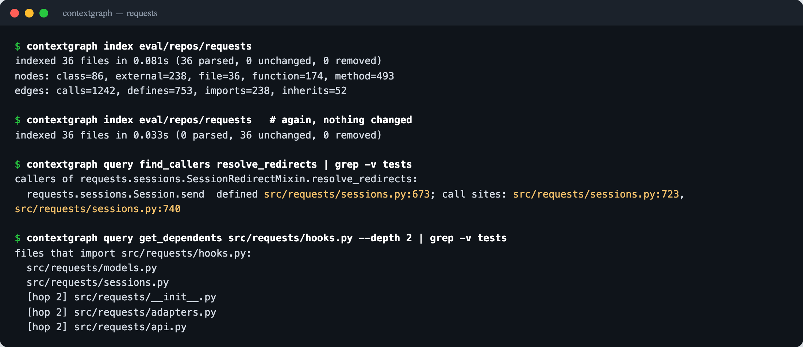
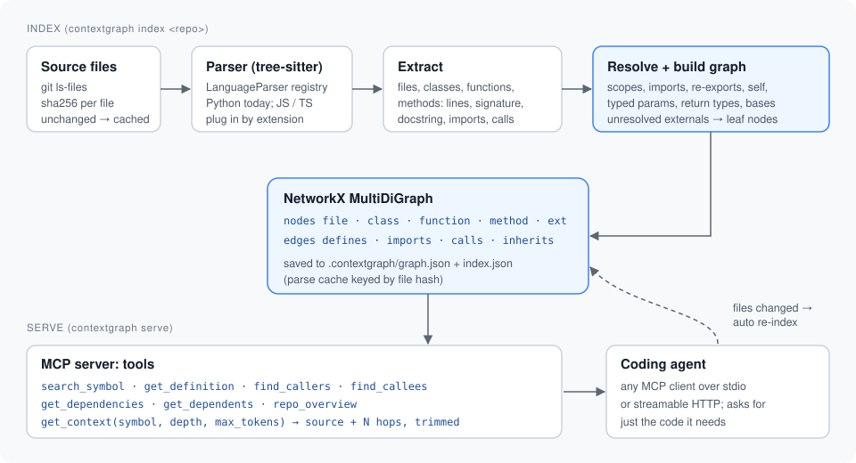
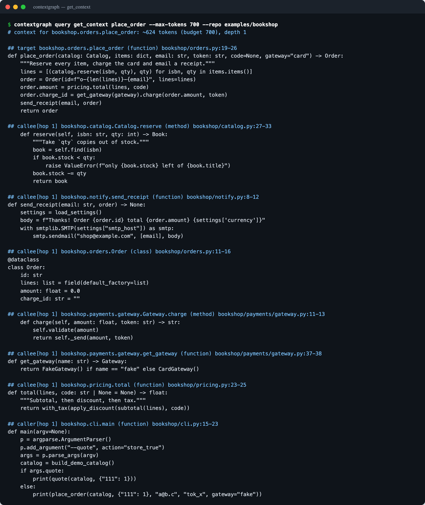
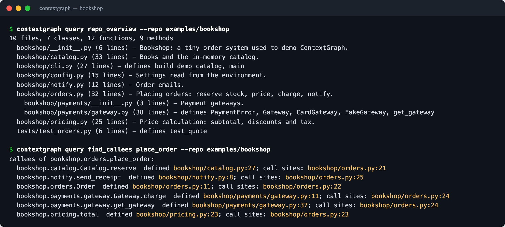

# ContextGraph

An MCP server that turns a codebase into a queryable graph, so AI coding agents fetch only the code they need instead of reading the whole repo.



## Why

On a large repo a coding agent either reads too much (whole files, wasted tokens) or too little (grep hits with no callers or dependencies). ContextGraph gives it a map of the code: what is defined where, what calls what, who imports whom. The agent asks a precise question and gets back a few hundred tokens instead of a few files.

## How it works



1. **Parse.** tree-sitter parses every source file. The parser layer is a small registry keyed by file extension (`contextgraph/parsers/`); Python ships today, and JavaScript/TypeScript can be added by implementing `LanguageParser`.
2. **Extract.** Each file yields
   - nodes: files, classes, functions and methods, with path, line range, signature and docstring
   - edges: `defines`, `imports`, `calls`, `inherits`
3. **Build the graph.** Everything goes into a NetworkX `MultiDiGraph`. Calls and imports are resolved to their definitions inside the repo through local scopes, imports, package re-exports (`from .sessions import Session` in `__init__.py`), `self`/`cls`/`super()`, annotated parameters (`catalog: Catalog` → `catalog.find()`), simple assignments (`x = Foo()`) and return annotations (`get_gateway(...).charge()`). Calls into other packages stay as external leaf nodes (`ext:os.path.join`). When the receiver's type is unknown, a call is linked only if the method name is unique in the repo, and the edge is marked `matched by name`.
4. **Index incrementally.** The graph and a per-file parse cache keyed by SHA-256 are saved to `<repo>/.contextgraph/`. Re-indexing only re-parses files whose hash changed (requests: 0.08 s cold, 0.03 s warm). The server checks for changed files every few seconds and refreshes on its own.
5. **Serve over MCP.**

| Tool | What it returns |
|---|---|
| `search_symbol(query, kind?)` | classes/functions/methods by name, best match first |
| `get_definition(symbol)` | the source of one symbol with file and line range |
| `find_callers(symbol, depth=1)` | who calls it, with call-site lines; `depth>1` follows callers of callers |
| `find_callees(symbol, depth=1)` | what it calls, in the repo and external |
| `get_dependencies(file)` | modules the file imports, split into in-repo and external |
| `get_dependents(file, depth=1)` | files that import it, optionally transitively |
| `get_context(symbol, depth=1, max_tokens=4000)` | the symbol plus callers and callees up to N hops, trimmed to a token budget |
| `repo_overview()` | module tree with one line per file |
| `reindex()` | force a refresh (normally automatic) |

Symbols can be passed as qualified names (`requests.sessions.Session.send`), dotted suffixes (`Session.send`) or bare names when unique. Ambiguous names return the candidates.

`get_context` puts the target's full source first, then neighbours by hop distance. A neighbour gets its full source if it fits the budget, otherwise its outline (signature, docstring, member signatures), otherwise it is listed under "omitted". Tokens are estimated at four characters per token.



## Quickstart

```bash
git clone https://github.com/meethjaswani/contextgraph && cd contextgraph
python -m venv .venv && source .venv/bin/activate
pip install -e ".[dev]"

contextgraph index examples/bookshop        # parse + build the graph
contextgraph query find_callers total --repo examples/bookshop
contextgraph serve examples/bookshop        # MCP over stdio
```

`contextgraph serve --transport http --port 8000` serves streamable HTTP at `http://127.0.0.1:8000/mcp` instead.

Add `.contextgraph/` to your repo's `.gitignore`.

## Connect it to an MCP client

Most MCP clients take a JSON block like this (the file name depends on the client, e.g. `.mcp.json`, `.cursor/mcp.json` or `.vscode/mcp.json`):

```json
{
  "mcpServers": {
    "contextgraph": {
      "command": "/path/to/contextgraph/.venv/bin/contextgraph",
      "args": ["serve", "/path/to/your/repo"]
    }
  }
}
```

The server sends instructions on connect telling the agent to start with `repo_overview` or `search_symbol` and to use `get_context` before reading whole files.

## Example tool calls

On the bundled sample repo (`examples/bookshop`, already indexed in `examples/bookshop/.contextgraph/`):



```text
> find_callers(symbol="with_tax", depth=2)
callers of bookshop.pricing.with_tax:
  bookshop.pricing.total  defined bookshop/pricing.py:23; call sites: bookshop/pricing.py:25
  [hop 2] bookshop.orders.place_order  defined bookshop/orders.py:19; call sites: bookshop/orders.py:23
  [hop 2] bookshop.orders.quote  defined bookshop/orders.py:29; call sites: bookshop/orders.py:32

> find_callers(symbol="Catalog.find")
callers of bookshop.catalog.Catalog.find:
  bookshop.catalog.Catalog.reserve  defined bookshop/catalog.py:27; call sites: bookshop/catalog.py:29
  bookshop.orders.quote  defined bookshop/orders.py:29; call sites: bookshop/orders.py:31

> get_dependents(file="bookshop/config.py", depth=2)
files that import bookshop/config.py:
  bookshop/notify.py
  bookshop/pricing.py
  [hop 2] bookshop/orders.py

> get_definition(symbol="_send")
error: '_send' is ambiguous, pass one of these qualified names:
  bookshop.payments.gateway.CardGateway._send  (method, bookshop/payments/gateway.py:24)
  bookshop.payments.gateway.FakeGateway._send  (method, bookshop/payments/gateway.py:33)
  bookshop.payments.gateway.Gateway._send  (method, bookshop/payments/gateway.py:19)
```

`quote` is found as a caller of `Catalog.find` because its `catalog` parameter is annotated as `Catalog`; `place_order → Gateway.charge` is found through the return annotation of `get_gateway`.

## Evaluation

<!-- EVAL:START -->
Results pending.
<!-- EVAL:END -->

### Method

- **Repos:** [requests](https://github.com/psf/requests) v2.32.3 (36 Python files), [click](https://github.com/pallets/click) 8.1.7 (71) and [rich](https://github.com/Textualize/rich) v13.7.1 (190).
- **Questions:** 30 in [`eval/questions.json`](eval/questions.json), ten per repo: who calls X, what does X inherit from, where is Y configured, what breaks if I change Z, which files import W. Every expected answer was checked by hand against the source with grep, not taken from the tool.
- **Agent:** the same tool-calling loop, model, prompt and temperature 0 in both modes, up to 20 turns. Baseline tools are `list_files`, `read_file` (300 lines per call) and `grep`. The ContextGraph mode gets the same three tools plus the eight graph tools, called in-process so they return exactly what the MCP server returns.
- **Grading:** an answer must name every expected item (case-insensitive, whole-word match). "Fully correct" counts answers that name all of them; "answer recall" is the share of expected items named. Tokens are prompt plus completion tokens summed over every model call in a run, as reported by the API. "Files read" counts distinct files opened with `read_file`.
- **Run it yourself:** put `CG_LLM_API_KEY=...` in `eval/.env` (any OpenAI-compatible endpoint; set `CG_LLM_BASE_URL` and `CG_LLM_MODEL` to change provider or model), then `pip install -e ".[eval]"` and `python eval/run_eval.py`. Per-run results land in `eval/results/`.

## Tests

```bash
pytest
```

30 tests cover the parser (symbols, signatures, docstrings, relative imports, call expressions, type hints, broken files), graph queries (resolution through re-exports, `self`, typed parameters and return types, transitive callers, dependents, token budgets), incremental indexing (unchanged, changed and deleted files) and the MCP server end to end through an in-process client.

## Layout

```
src/contextgraph/
  parsers/        LanguageParser interface, registry, Python parser
  models.py       Symbol / Import / Call / FileResult records
  graph.py        graph builder, name resolution, queries
  indexer.py      file discovery, hashing, save/load
  tools.py        text output shared by the server and the CLI
  server.py       MCP server
  cli.py          contextgraph index | serve | query
examples/bookshop sample repo with its index committed
eval/             questions, harness, results
tests/
```

## Limits

- Python only for now.
- Calls through untyped variables, containers, `getattr` and dynamic dispatch are only linked when the method name is unique in the repo, and those edges are marked as name matches.
- Line numbers come from the last index; the server re-indexes when files change, but a query in the same second as an edit can see the old lines.

## License

MIT
